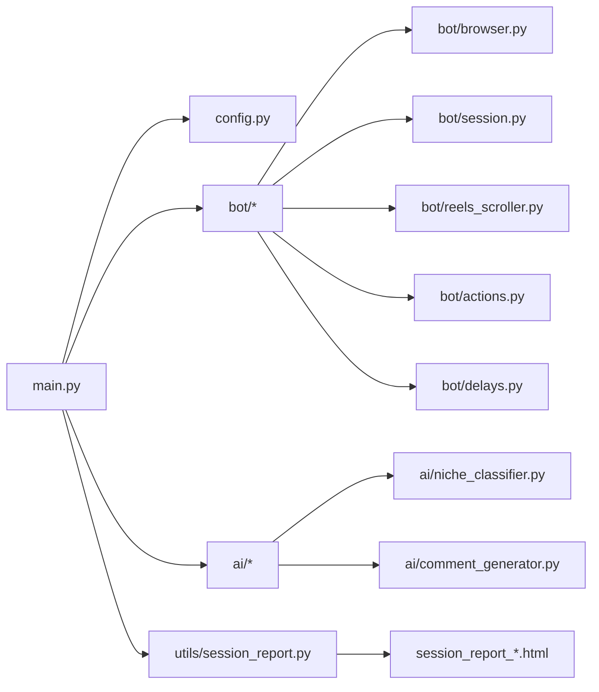

## Instagram Growth Bot (Reels Automation)

Production-style, modular Instagram Reels engagement bot built with **Python + Playwright**, with niche targeting (designers/founders/builders), AI-assisted comments (OpenRouter), safety limits, and a **live session report** (HTML + charts).

> **Important**: Automating Instagram can violate Instagram’s Terms and may trigger action blocks or bans. Use conservatively, keep limits low, and prefer short sessions with breaks.

---

### Features

- **Human-like Reels browsing**: watch time, random idle, scroll, mouse movement
- **Targeted engagement**: niche detection from caption/hashtags + AI fallback
- **Actions**: like reels, comment, follow reel creator, follow random commenters, like random comments
- **Safety**: hourly caps + delays (configurable)
- **Session persistence**: cookie reuse to avoid logging in every run
- **Live report**: `session_report_YYYYMMDD_HHMMSS.html` with tables + charts

---

### Quickstart (Windows / PowerShell)

```powershell
cd G:\ig-growth\instagram_bot
python -m venv .venv
.\.venv\Scripts\Activate.ps1
pip install -r requirements.txt
python -m playwright install chromium
Copy-Item .env.example .env
notepad .env
python main.py
```

When the browser opens, complete any login / 2FA / challenge if Instagram asks.

---

### Configuration

All settings are in `instagram_bot/config.py`:

- **Limits**: `MAX_LIKES_PER_HOUR`, `MAX_COMMENTS_PER_HOUR`, `MAX_FOLLOWS_PER_HOUR`, `MAX_SESSION_HOURS`
- **Delays**: `REEL_WATCH_*`, `SCROLL_DELAY_*`, `LIKE_DELAY_*`, `COMMENT_DELAY_*`, `FOLLOW_DELAY_*`, `RANDOM_IDLE_*`
- **Engagement weights** (niche reels): `NICHE_LIKE_PROBABILITY`, `NICHE_COMMENT_PROBABILITY`, `NICHE_FOLLOW_PROBABILITY`
- **AI usage**: `COMMENT_USE_AI_PROBABILITY` (0–1)
- **Targeting**: niche keywords + `TARGET_HASHTAGS`

Secrets go in `instagram_bot/.env`:

- `OPENROUTER_API_KEY`
- `INSTAGRAM_USER`
- `INSTAGRAM_PASS`

---

### Project structure

```text
ig-growth/
  README.md
  instagram_bot/
    main.py
    config.py
    run.ps1
    requirements.txt
    .env.example
    bot/
      actions.py
      browser.py
      delays.py
      reels_scroller.py
      session.py
    ai/
      comment_generator.py
      niche_classifier.py
    utils/
      logger.py
      session_report.py
```

---

### Workflow (high level)

```mermaid
flowchart TD
  A[Start bot] --> B[Load .env + config]
  B --> C[Launch Playwright browser]
  C --> D[Load cookies (if exist)]
  D --> E{Logged in?}
  E -- No --> F[Login + handle challenge/2FA]
  E -- Yes --> G[Open Reels feed / Hashtag source]
  F --> G

  G --> H[Watch reel (random)]
  H --> I[Extract caption + hashtags + author]
  I --> J[Niche detection: keywords → AI fallback]
  J --> K{Niche?}
  K -- No --> S[Scroll to next reel]
  K -- Yes --> L[Decide action by weights + limits]
  L --> M[Like / Comment / Follow / Skip]
  M --> N[Optional: follow commenter]
  N --> O[Optional: like random comments]
  O --> P[Update live session report]
  P --> S
  S --> H
```

---

### Architecture



---

### Session report (live)

Each run creates a new report file at repo root:

- `session_report_YYYYMMDD_HHMMSS.html`

It includes:
- totals: **reels viewed**, follows, reel likes, comments, comment likes
- tables with **links** (profile + reel URLs where available)
- a bar chart for quick inspection

---

### Notes for safety

- Keep **hourly limits conservative** (especially comments/follows).
- Run in **short sessions** (e.g. 1–4 hours) with breaks.
- Avoid repetitive, templated comments.
- If Instagram removes comments or shows restrictions: **stop activity 24–48 hours**.

